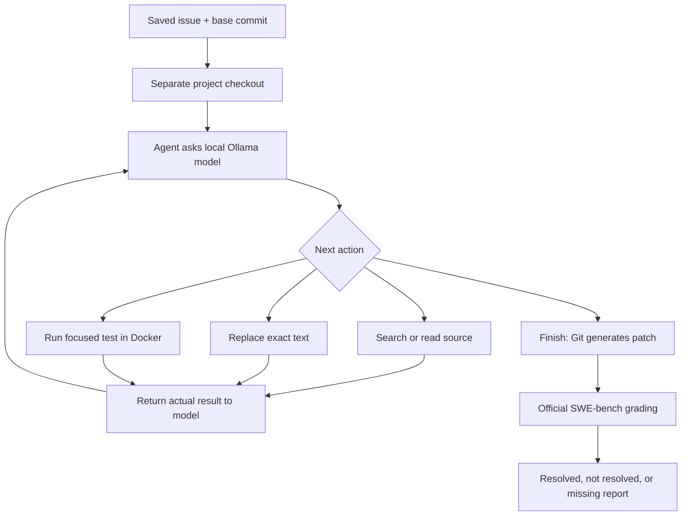

# How this project works, in simple terms

## 1. What we are trying to do

We give a local language model a real bug report and the version of a project
that contains the bug. The model must inspect the code, make a repair, and
check its work. SWE-bench supplies the bug reports and a way to grade repairs.

A SWE-bench task is a historical issue linked to a repair. We produce a patch
for that issue; we are not opening or merging a new GitHub pull request.
The target is 4–5 **officially resolved issues**. That target is not guaranteed.

## 2. The four main pieces

| Piece | Easy explanation | Code |
|---|---|---|
| Ollama + model | The engine that reads messages and decides the next action | `agent.py` calls Ollama |
| Agent loop | The coordinator that asks, acts, observes and repeats | `agent.py` |
| Repository tools | The agent's hands: find, read and change code | `workspace.py` |
| Test and grading systems | Check the repair in the project's environment | `testing.py`, `evaluate.py` |

`benchmark.py` connects these pieces, selects tasks, prepares checkouts and
saves results. A checkout is a separate folder containing a particular version
of a project. These are independent Git clones, not Git worktrees.

There are two choices for the coordinator: `--engine jiang` uses our small
Python loop, while `--engine claude` uses the downloaded Claude Code program.
Both use the same local model service and repository/test tools. Keep their
measurements separate because their prompting and conversation handling differ.



## 3. Why the original run failed

The first runner had a path bug: Git looked for patch files inside the wrong
directory. Those errors could not measure the model's repair ability.

After that bug was fixed, all ten patches still failed local validation.
The deeper design problems were:

- The model saw an alphabetically limited file list, README and packaging
  files, but usually not the implementation of the bug. It had to guess code.
- It had no search or read tool to ask for missing information.
- It had to write a unified diff, including line counts. Incorrect counts
  made patches invalid even before anyone could test the intended change.
- A retry sent the same context and an error, but omitted the previous answer.
- The code did not set the model's context size. A long prompt could exceed
  the serving configuration; actual truncation was not recorded in that run.
- The dataset has no generic `test_command` field. Therefore the supposed
  testing stage did not give the agent useful test feedback.
- Rerunning deleted checkouts, some errors were not saved, and retries did not
  preserve every prompt and response.

So the 0/10 local result reflects **both the model and a weak agent design**.
It was premature to say the model alone was the limitation. Also, local patch
rejection does not replace running the official evaluator, whose application
behavior can differ.

## 4. What happens during one new attempt

1. **Prepare the exact starting code.** The runner checks out the dataset's
   `base_commit`, a Git identifier for the buggy version. It can copy an old
   local clone to avoid downloading the repository again.
2. **Choose and send a small starting message.** Before cloning, the runner
   ranks tasks by the dataset's difficulty label. It prefers `<15 min fix`
   issues, then issues estimated at `15 min - 1 hour`, while keeping one task
   per repository before filling more slots. Reproduction code and clear
   expected behavior break ties. This is a scheduling heuristic, not proof
   that a task will be easy. The model then gets the issue and a shortlist
   of possibly relevant files, ranked by terms from the issue. It does not get
   the reference solution, hidden test patch, or evaluation script.
3. **Ask for one action.** Ollama returns JSON, a small structured message such
   as `{"action":"search","query":"some_function"}`. A schema constrains the
   response format; it cannot guarantee that the chosen action is correct.
4. **Execute that action.** The Python runner searches or reads actual files
   and returns the result. The model can keep asking until it understands the
   code. Existing tests are readable.
5. **Edit exact text.** With Docker enabled, a baseline test request is required
   before the first edit. The model supplies existing text and its replacement.
   The runner only accepts a unique match in a file the model has read. Python
   syntax is checked before saving. A mistaken match produces feedback.
6. **Test and revise.** A test command runs in a fresh Docker container. The
   current patch is copied into the container and applied to the base commit.
   Output and exit status return to the model so it can investigate failures.
7. **Review and finish.** The model is instructed to inspect the diff and, when
   testing is enabled, request a test against the latest patch before finishing.
   The custom loop enforces this; the Claude backend currently prompts for it
   but can stop without completing these checks. The
   default budget is 30 actions; reaching the limit also ends an attempt.
8. **Save and grade.** Git writes the patch. A separate official evaluation
   checks the benchmark's required tests and reports whether the issue resolves.

In the custom Jiang backend, the conversation is retained between actions. To keep it within memory, the
runner drops the oldest complete action/result pairs when a conservative
character budget is exceeded. The issue and system instructions remain, and
the complete trajectory stays on disk. This is a simple budget approximation,
not exact token counting; forgetting old observations remains a limitation.
Claude Code manages its own conversation when using the Claude backend.
For the constrained Claude configuration, automatic compaction is disabled:
its default reserve caused repeated compaction after only a few thousand tokens.
An overlong session must stop or be rerun with a larger context; it is not an
unlimited-memory agent. The Claude default is now 32K after a 16K pilot hit the
context limit. The custom backend retains its 16K bounded-history policy.

## 5. Why these design choices were made

**Local inference:** Ollama serves the downloaded model at `127.0.0.1:11434`.
That address means this computer. The client rejects remote endpoints, cloud
tags and reported remote model aliases. Downloads still use the internet;
the reasoning runs locally.

**Small explicit actions:** They are easier to inspect and debug than a giant
answer. JSON actions also work with models that do not support native tool
calling. A model's native tool support is a separate capability.

**Git-generated patches:** The model concentrates on changing code. Git handles
diff headers and line numbers reliably.

**Docker tests:** Old projects often need old Python and dependency versions.
Running them in the host's Python 3.13 environment would produce misleading
setup failures. The dataset's image supplies its environment. On this Apple
Silicon Mac, the x86-64 images require emulation and can be slower.

**Fresh container for each test:** One test cannot leave behind edits that
silently affect a later test. Agent test containers have no network or mounted
host directories. The runner copies the candidate patch in. Downloaded images
are retained for reuse; disposable test containers are removed after the call.

**Separate official grading:** Agent-selected tests can pass while missing the
bug. Grading uses the hidden regression tests and checks previously passing
tests too. Only an official report with `resolved: true` counts as resolved.
The agent never receives the hidden test patch or the reference solution.
The official harness has its own container configuration; our test-container
restrictions do not claim to modify the upstream harness.

**Resume and separate outputs:** Results are saved after every task. A rerun
skips completed tasks; an interrupted attempt is archived before restarting.
Changing the model or budget requires a new output directory. This makes
comparisons traceable and preserves failures.

## 6. Is Gemma better?

We have not measured that here. A different model may improve reasoning, but
the earlier failures cannot establish that Gemma would win.

The inspected Mac has **16 GB RAM**. The installed `qwen2.5-coder:7b` uses about
4.7 GB on disk. Model memory also needs room for conversation history, macOS,
Docker and other apps; download size is not total runtime memory.

My next comparison candidate is **`qwen3.5:9b`**, listed at about 6.6 GB. It is a
plausible upgrade to evaluate, not a proven winner on these issues. A Gemma
alternative is **`gemma4:12b`**, listed at about 7.6 GB. Gemma's larger 26B/31B
variants have downloads larger than this Mac's RAM, so they are poor starting
choices here. The generic `gemma4` tag is not necessarily the smallest variant.
Sources: [Qwen 3.5](https://ollama.com/library/qwen3.5),
[Gemma 4](https://ollama.com/library/gemma4).

Start with a 16,384-token context for the custom loop, or 32,768 for Claude,
one model, one task and one test container.
This is a practical memory compromise, not a claim that longer contexts never
help. Ollama's model maximum and its actual configured context are different.
Source: [Ollama context documentation](https://docs.ollama.com/context-length).

Compare both models using the same task IDs, action limit and settings.
Report official resolutions, environment failures and elapsed time. If making
several attempts per task, show both first-attempt results and the best result
across the stated number of attempts. Do not hide unsuccessful attempts or
select tasks using reference patches just to reach 4–5 successes.

For practical pilots, the default selector is `--selection easy`. It uses only
public task metadata and issue text; it never reads the gold patch or hidden
tests. `--selection balanced` is available for an instance-ID-ordered baseline.
When a supplied experiment list must be followed exactly, the runner accepts
`--preferred-ids-file`. The ten IDs in
`configs/swebench_9b_priority.txt` are validated against the full dataset and
run in the file's order, including repeated Django tasks. The file is recorded
in the manifest so the historical solve-rate ordering is reproducible. Those
historical percentages are a scheduling input, not a result produced by this
agent.

## 7. Where Claude Code fits

Claude Code is an agent program; the Claude model is a different component.
Claude Code can use Ollama's Anthropic-compatible local endpoint. The earlier
report implied that local use was unavailable; that was incorrect.
Source: [Ollama's Claude Code guide](https://docs.ollama.com/integrations/claude-code).

`claude_local.py` provides a separate connection check and an interactive
read/edit/search launcher. `claude_agent.py` also integrates Claude Code into
the automated benchmark via `--engine claude`.

```text
Benchmark runner -> Claude Code -> local adapter -> local Ollama model
                         |
                         v
                 MCP repository tool -> read/edit/search/Docker test
```

MCP is a standard way for an agent program to call a tool. The small
`mcp_tools.py` server exposes our existing `Workspace` actions to Claude Code.
Claude Code decides which tool calls to make and runs its own conversation
loop. Its built-in shell, web and file tools are disabled for benchmark runs,
so repository access goes through the bounded tool. The tool server does
not expose the reference answer or full dataset.

This backend creates a local model alias with explicit context/sampling
settings. It uses a short replacement system prompt to fit this Mac's memory.
The native CLI's turn limit and our tool-action budget are both applied.
Tool results show the remaining budget and remind the model to reproduce the
bug after five actions without a test, rather than endlessly search for tests.
The small `local_proxy.py` adapter only listens on this computer. It forwards
model messages to local Ollama and explicitly supplies the thinking setting,
temperature, selected model and maximum response length. This was needed because
setting Claude's thinking preference alone still produced thinking output from
Ollama in a pilot. The adapter records the controls it actually sent. A direct
probe found that Ollama 0.20.4 still emitted thinking blocks despite an explicit
disabled setting on this endpoint. Therefore the requested setting and actual
behavior must be reported separately; the adapter does not fix that server bug.
It does not generate answers or edit code. All inference remains on this Mac.
Source: [Ollama's Anthropic compatibility](https://docs.ollama.com/api/anthropic-compatibility).
Related upstream report: [Anthropic endpoint thinking behavior](https://github.com/ollama/ollama/issues/15287).
Claude Code needs a model with native tools for normal tool use; Jiang's JSON
protocol does not have that requirement. Ollama recommends 64K or more context
for Claude Code, which is a heavier memory demand than our compact loop.

The assignment explicitly asks for Claude Code or a downloaded alternative,
then use of that agent on ten issues. Use **`--engine claude`** for those measured
runs. A custom Jiang run and a separate Claude Code smoke test alone would not
satisfy that wording. Do not label custom-loop results as Claude Code results.

## 8. Remaining limitations

The current editor changes existing tracked files only and blocks edits to
common test paths. It cannot add a new module. This deliberately small toolset
will limit some repairs. Syntax checks use host Python, so very old syntax may
need a container-based checker. Character-based context budgeting is approximate.
Test environments can fail to import compiled extensions or need an editable
install; those errors must be analyzed separately from repair quality.

Before a 10-task run, grade a small pilot. If it fails, inspect its trajectory
and improve a general capability such as source discovery or test execution.
Do not manually supply the benchmark fix and describe it as an autonomous
local-model repair. The commands and output file locations are in `README.md`.
